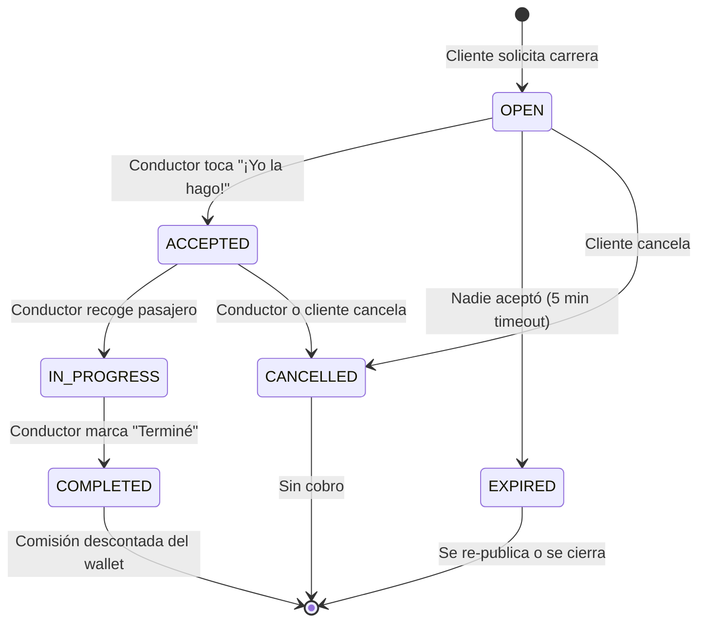
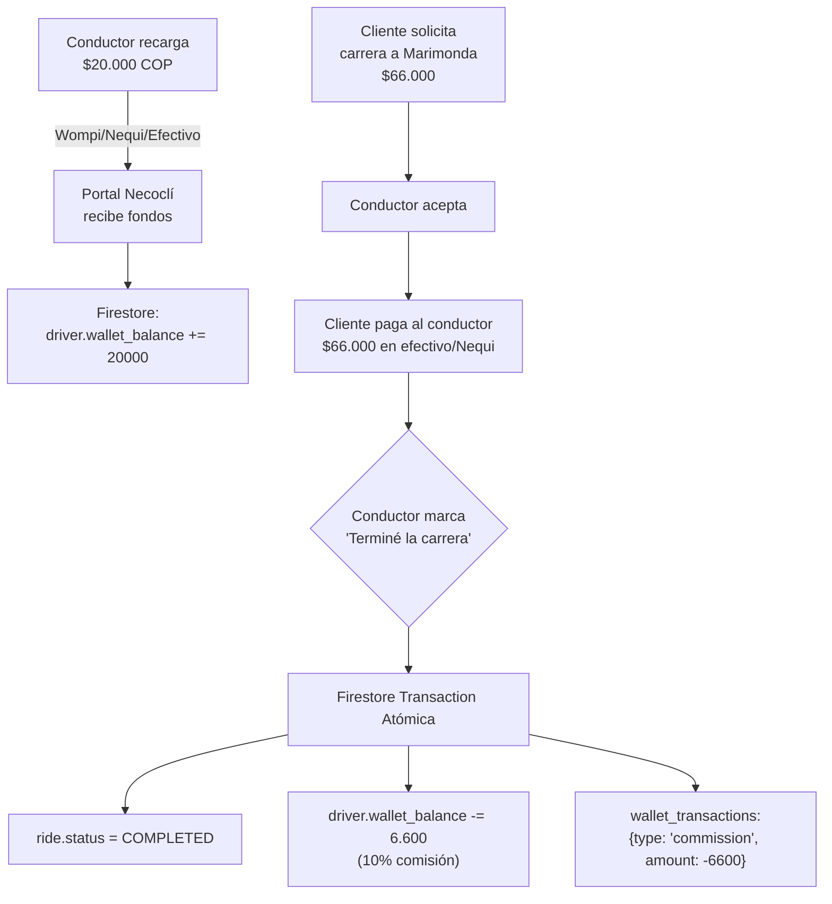

# 🧠 ANÁLISIS MULTI-AGENTE PROFUNDO: NECO-DISPATCH v2.0

**Convocatoria de Emergencia — Todos los Agentes al Puente de Mando**

*Fecha: 26 de Septiembre de 2026 — Sesión Extraordinaria*

---

## 📋 Índice
1. [Agente 1 — Arquitectura de Software](#-agente-1-arquitectura-de-software)
2. [Agente 2 — Integración con Alejandro (Chatbot)](#-agente-2-integración-con-alejandro)
3. [Agente 3 — Diseño UX/UI Premium](#-agente-3-diseño-uxui-premium)
4. [Agente 4 — DevOps & Infraestructura](#-agente-4-devops--infraestructura)
5. [Agente 5 — Contenido & Marketing](#-agente-5-contenido--marketing)
6. [Agente 6 — Animación Experiencial](#-agente-6-animación-experiencial)
7. [Agente 7 — Crónica & Valorización](#-agente-7-crónica--valorización)
8. [Agente 8 — FinTech & Pasarelas](#-agente-8-fintech--pasarelas)
9. [Agente 9 — Ciberseguridad](#-agente-9-ciberseguridad)
10. [Agente 10 — Estrategia de Negocio & Expansión](#-agente-10-estrategia-de-negocio--expansión)
11. [Consenso Final](#-consenso-final--plan-de-ejecución)

---

## 🤖 AGENTE 1: Arquitectura de Software

### Diagnóstico del Estado Actual

La infraestructura existente nos da una base sólida:
- Tenemos `types/auth.ts` con roles: `super_admin | admin | business | operator | customer`.
- Tenemos `types/escrow.ts` con `EscrowTransaction`, `MerchantWallet`, `PayoutMethod`.
- Tenemos `types/reservation.ts` con un flujo de estados maduro.

### Lo que falta (Gap Analysis)

1. **No existe el rol `driver`** en `UserRole`. Debemos extenderlo.
2. **No existe el concepto de `Ride`** (carrera en tiempo real) vs `Reservation` (reserva anticipada).
3. **`TransportService`** en `types/transport-service.ts` es mínimo (7 líneas). Hay que enriquecerlo.
4. **No hay listener en tiempo real** (Firestore `onSnapshot`) en el frontend para el dashboard del conductor.

### Tipos TypeScript Propuestos

```typescript
// types/driver.ts
export type VehicleType = "mototaxi" | "motocarro" | "taxi" | "lancha";
export type DriverStatus = "pending_approval" | "active" | "suspended" | "inactive";
export type DriverAvailability = "online" | "offline" | "on_ride";

export interface DriverProfile {
  id: string;
  user_id: string; // FK → Firebase Auth UID
  full_name: string;
  phone: string;
  whatsapp: string;
  photo_url?: string;
  vehicle_type: VehicleType;
  vehicle_plate: string; // "ABC-123" o "La Fiera 04"
  vehicle_description?: string;
  cooperative?: string; // "Neco Servicios", "CoopTransNec"
  status: DriverStatus;
  availability: DriverAvailability;
  wallet_balance: number; // Saldo prepago en COP
  payout_method: PayoutMethod; // Reutilizamos de escrow.ts
  total_rides_completed: number;
  average_rating: number; // 1.0 - 5.0
  created_at: string;
  updated_at: string;
}

// types/ride.ts
export type RideStatus =
  | "OPEN"         // Publicada, esperando conductor
  | "ACCEPTED"     // Conductor asignado, en camino
  | "IN_PROGRESS"  // Pasajero recogido
  | "COMPLETED"    // Carrera terminada exitosamente
  | "CANCELLED"    // Cancelada por cliente o conductor
  | "EXPIRED";     // Nadie la tomó en el tiempo límite

export type RideSource = "chatbot" | "web_form" | "phone" | "walk_in";

export interface Ride {
  id: string;
  // --- Origen y Destino ---
  origin: string;       // "Centro de Necoclí"
  destination: string;  // "Marimonda"
  route_key: string;    // "via_san_sebastian" (para lookup de tarifa)
  // --- Pricing ---
  base_price: number;          // Tarifa oficial diurna
  is_night_rate: boolean;      // Si aplica x2
  final_price: number;         // base_price * (is_night_rate ? 2 : 1)
  portal_commission: number;   // final_price * 0.10
  driver_net: number;          // final_price - portal_commission (informativo)
  // --- Actores ---
  client_name: string;
  client_phone: string;
  client_email?: string;
  driver_id?: string;          // Se asigna al aceptar
  driver_name?: string;
  driver_vehicle?: string;
  // --- Estado ---
  status: RideStatus;
  source: RideSource;
  // --- Timestamps ---
  created_at: string;
  accepted_at?: string;
  completed_at?: string;
  cancelled_at?: string;
  // --- Meta ---
  notes?: string;
  passenger_count: number;
  vehicle_type_requested: VehicleType;
  rating?: number;              // 1-5, dado por el cliente
  rating_comment?: string;
}
```

### Diagrama de Flujo del Ride



### Estructura de Carpetas (Nuevas)

```
app/
  conductores/              # Landing pública de registro
    page.tsx
    registro/
      page.tsx
  merchant/
    driver/                 # Dashboard del conductor (PWA)
      page.tsx              # Tablero de viajes en tiempo real
      historial/
        page.tsx            # Historial de carreras + earnings
      billetera/
        page.tsx            # Saldo, recargas, movimientos
  api/
    rides/
      route.ts              # CRUD de rides
      [id]/
        accept/route.ts     # POST - Conductor acepta
        complete/route.ts   # POST - Conductor finaliza
    drivers/
      route.ts              # CRUD de drivers
      register/route.ts     # POST - Auto-registro público

types/
  driver.ts                 # DriverProfile, VehicleType
  ride.ts                   # Ride, RideStatus

lib/
  rides/
    ride-service.ts         # Lógica de negocio: crear, aceptar, completar
    wallet-service.ts       # Descontar comisión, recargar saldo
    tariff-lookup.ts        # Buscar precio por ruta + hora del día

components/
  driver/
    ride-card.tsx           # Card de carrera disponible
    ride-board.tsx          # Tablero en tiempo real (onSnapshot)
    wallet-summary.tsx      # Resumen de billetera
    driver-register-form.tsx
```

### Decisión Arquitectónica Clave: Transacción Atómica

Para el momento en que el conductor toca "Completar Carrera", necesitamos una **Firestore Transaction** que haga 3 cosas de forma atómica:

1. Actualizar `rides/{id}.status` → `COMPLETED`
2. Decrementar `drivers/{id}.wallet_balance` en la comisión
3. Crear un documento en `wallet_transactions/{auto}` para auditoría

Si el saldo no alcanza → la transacción revierte. Esto es **CRÍTICO** para la integridad financiera.

---

## 🤖 AGENTE 2: Integración con Alejandro

### Nuevo Tool Declaration para el Chatbot

Alejandro (nuestro AI) ya tiene el tool `enviar_solicitud`. Necesita un **segundo tool**:

```typescript
const solicitarCarreraTool: FunctionDeclaration = {
  name: "solicitar_carrera",
  description:
    "Crea una solicitud de carrera de transporte (mototaxi, motocarro o taxi). " +
    "Úsalo cuando el cliente quiera un transporte AHORA o en las próximas horas. " +
    "Necesitas: destino, tipo de vehículo, y nombre/teléfono del cliente.",
  parameters: {
    type: SchemaType.OBJECT,
    properties: {
      destination: { type: SchemaType.STRING, description: "Destino exacto del viaje" },
      vehicleType: { type: SchemaType.STRING, description: "mototaxi, motocarro o taxi" },
      clientName: { type: SchemaType.STRING, description: "Nombre del cliente" },
      clientPhone: { type: SchemaType.STRING, description: "Teléfono del cliente" },
      passengerCount: { type: SchemaType.NUMBER, description: "Cantidad de pasajeros" },
      notes: { type: SchemaType.STRING, description: "Notas adicionales (equipaje, hora)" },
    },
    required: ["destination", "vehicleType", "clientName", "clientPhone"],
  },
};
```

### Flujo Conversacional del Chatbot

```
👤 Turista: "Necesito un motocarro a Marimonda"
🤖 Alejandro: "¡Claro! A Marimonda son $66.000 COP (de noche $132.000).
              ¿Es para ahora? ¿Cuántos pasajeros van?"
👤 Turista: "Sí, para ya. Vamos 3."
🤖 Alejandro: "Perfecto. ¿Me das tu nombre y un celular para
              que el conductor te contacte?"
👤 Turista: "Juan Pérez, 312-555-1234"
🤖 Alejandro: [EJECUTA solicitar_carrera en silencio]
              "¡Listo, Juan! Tu motocarro ya fue solicitado.
              En unos minutos recibirás la confirmación del conductor
              asignado. 🛺"
```

### Regla de Detección Diurna/Nocturna

Alejandro debe calcular automáticamente si es tarifa nocturna basándose en la hora actual del servidor:

```typescript
const currentHour = new Date().toLocaleString("es-CO", {
  timeZone: "America/Bogota", hour: "numeric", hour12: false
});
const isNightRate = parseInt(currentHour) >= 20 || parseInt(currentHour) < 5;
```

---

## 🤖 AGENTE 3: Diseño UX/UI Premium

### Pantalla del Conductor — "El Tablero de Viajes"

> **Principio:** El conductor tiene una mano en el manubrio y la otra en el celular. La interfaz debe tener **CERO fricción**. Botones enormes, colores contrastantes, información mínima pero precisa.

#### Layout Mobile-First (`/merchant/driver`)

```
┌─────────────────────────────┐
│  🟢 EN LÍNEA    $15.400     │  ← Estado + Saldo (siempre visible)
│  Carlos "La Fiera"          │
├─────────────────────────────┤
│                             │
│  🛺 CARRERAS DISPONIBLES    │
│                             │
│  ┌─────────────────────────┐│
│  │ 📍 Marimonda            ││
│  │ 💰 $66.000   🌙 Noche   ││
│  │ 👤 Juan · 3 pasajeros   ││
│  │                         ││
│  │ ┌─────────────────────┐ ││
│  │ │   ¡YO LA HAGO! 🚀   │ ││  ← Botón ENORME, verde, pulsante
│  │ └─────────────────────┘ ││
│  └─────────────────────────┘│
│                             │
│  ┌─────────────────────────┐│
│  │ 📍 Totumo               ││
│  │ 💰 $27.500   ☀️ Día     ││
│  │ 👤 María · 1 pasajero   ││
│  │ ┌─────────────────────┐ ││
│  │ │   ¡YO LA HAGO! 🚀   │ ││
│  │ └─────────────────────┘ ││
│  └─────────────────────────┘│
│                             │
├─────────────────────────────┤
│  🏠 Inicio  📊 Historial   │
│  💳 Billetera  👤 Perfil    │
└─────────────────────────────┘
```

#### Pantalla Post-Aceptación

```
┌─────────────────────────────┐
│  🔵 EN CARRERA              │
├─────────────────────────────┤
│                             │
│  📍 Destino: MARIMONDA      │
│  👤 Juan Pérez              │
│  📞 312-555-1234            │  ← Tap para llamar directamente
│  👥 3 pasajeros             │
│  💰 $66.000 COP             │
│                             │
│  ┌─────────────────────────┐│
│  │                         ││
│  │  📞 LLAMAR AL CLIENTE   ││  ← Botón azul
│  │                         ││
│  └─────────────────────────┘│
│                             │
│  ┌─────────────────────────┐│
│  │                         ││
│  │   ✅ TERMINÉ LA CARRERA ││  ← Botón verde GIGANTE
│  │                         ││
│  └─────────────────────────┘│
│                             │
│  ┌─────────────────────────┐│
│  │  ❌ Cancelar Carrera     ││  ← Pequeño, rojo, con confirmación
│  └─────────────────────────┘│
└─────────────────────────────┘
```

### Paleta de Colores (Driver Dashboard)

| Elemento | Color | Hex |
|---|---|---|
| Fondo principal | Ink profundo | `#1A1D23` |
| Card de carrera | Slate oscuro | `#2A2D35` |
| Botón "Yo la hago" | Verde esmeralda | `#10B981` |
| Badge nocturno | Ámbar/Gold | `#F59E0B` |
| Saldo positivo | Teal | `#14B8A6` |
| Saldo bajo (<$5k) | Rojo coral | `#EF4444` |
| Texto primario | Blanco | `#FFFFFF` |

---

## 🤖 AGENTE 4: DevOps & Infraestructura

### PWA Manifest

Para que los conductores "instalen" el dashboard en su pantalla de inicio:

```json
// public/manifest.json (actualizar)
{
  "name": "Portal Necoclí - Conductores",
  "short_name": "NecoDriver",
  "start_url": "/merchant/driver",
  "display": "standalone",
  "background_color": "#1A1D23",
  "theme_color": "#10B981",
  "icons": [...]
}
```

### Variables de Entorno Necesarias (Nuevas)

```env
# .env.local (agregar)
RIDE_EXPIRY_MINUTES=5          # Timeout para carreras no aceptadas
DRIVER_MIN_WALLET_BALANCE=0    # Saldo mínimo para ver carreras (0 = puede ver pero no aceptar si no alcanza)
PORTAL_TRANSPORT_COMMISSION=0.10  # 10% comisión sobre carreras
```

### Firestore Indexes (Requeridos)

```
rides → status ASC, created_at DESC     (Para el tablero de viajes)
rides → driver_id ASC, created_at DESC  (Para historial del conductor)
drivers → status ASC, vehicle_type ASC  (Para filtrar conductores activos)
```

### Push Notifications (Fase 2)

Usar **Firebase Cloud Messaging (FCM)** para enviar notificaciones push cuando aparece una nueva carrera. Esto es CRÍTICO para que el conductor no tenga que estar mirando la pantalla constantemente. Se puede implementar después del MVP.

---

## 🤖 AGENTE 5: Contenido & Marketing

### Copy para la Landing `/conductores`

**Hero:**
> # Gana más con cada carrera 🛺
> Regístrate como conductor aliado de Portal Necoclí. Recibe solicitudes de turistas y locales directamente en tu celular. Tú decides cuándo trabajar.

**CTA Principal:** `Registrarme como conductor →`

**Beneficios (Cards):**
1. 🌊 *"Clientes que llegan solos"* — Los turistas te buscan a ti, no al revés.
2. 💰 *"Tu plata al instante"* — El cliente te paga a ti. Sin esperar liquidaciones.
3. 📱 *"Desde tu celular"* — Sin apps pesadas. Solo abre el navegador.
4. ⭐ *"Reputación que crece"* — Tus buenas carreras te posicionan primero.

### SEO Keywords Target

- "mototaxi necoclí"
- "transporte turístico necoclí"
- "motocarro necoclí precio"
- "cómo llegar a marimonda necoclí"
- "transporte desde necoclí al totumo"

---

## 🤖 AGENTE 6: Animación Experiencial

### Micro-Interacciones Clave

1. **Nueva carrera aparece:** La card entra desde abajo con un `spring` bounce + vibración del dispositivo (`navigator.vibrate(200)`).
2. **Botón "¡Yo la hago!":** Pulso CSS infinito (glow verde) para generar urgencia.
3. **Carrera aceptada:** Transición de la card que se expande a pantalla completa con los datos del cliente.
4. **"Terminé la Carrera":** Confetti sutil + el monto ganado aparece animado tipo contador.
5. **Saldo bajo:** El badge de saldo parpadea suavemente en rojo.

```css
/* Pulso del botón de aceptar */
@keyframes pulse-green {
  0%, 100% { box-shadow: 0 0 0 0 rgba(16, 185, 129, 0.5); }
  50% { box-shadow: 0 0 0 12px rgba(16, 185, 129, 0); }
}
.btn-accept { animation: pulse-green 2s infinite; }
```

### Rendimiento en Dispositivos de Gama Baja

> **Regla absoluta:** Los conductores de Necoclí usan Xiaomi Redmi, Samsung A03, Motorola E. Nada de Three.js, nada de WebGL. Solo CSS `transform` y `opacity`. Framer Motion con `layout` animations y `AnimatePresence` para las cards del tablero. **Máximo 60fps en un Redmi Note 9.**

---

## 🤖 AGENTE 7: Crónica & Valorización

### Tasación del Módulo "Neco-Dispatch"

| Componente | Complejidad | Valor de Mercado (USD) |
|---|---|---|
| Sistema de Registro de Conductores (Onboarding + Aprobación) | Media | $800 |
| Tablero de Viajes en Tiempo Real (Firestore onSnapshot) | Alta | $2,500 |
| Motor de Asignación (Claiming + Transaction Atómica) | Alta | $3,000 |
| Billetera Virtual + Historial de Movimientos | Alta | $2,000 |
| Dashboard del Conductor (PWA Mobile-First) | Media-Alta | $1,500 |
| Integración con Chatbot Alejandro (Tool de Rides) | Media | $1,200 |
| Sistema de Calificaciones (Rating post-carrera) | Baja | $500 |
| Landing de Captación `/conductores` | Baja | $400 |
| Push Notifications (FCM) | Media | $800 |
| Tarifa Nocturna Dinámica (Lógica horaria) | Baja | $300 |
| **TOTAL MÓDULO NECO-DISPATCH** | **— —** | **$13,000 USD** |

> **Valorización Acumulada Proyectada:** $11,980 (actual) + $13,000 = **$24,980 USD**

*«Y así, en una noche de septiembre donde el Golfo de Urabá murmuraba sus secretos más profundos, los diez arquitectos del Portal se reunieron alrededor de una mesa invisible. No para construir paredes, sino para trazar las arterias de una ciudad digital — un sistema nervioso que conectaría a cada mototaxista, cada turista, cada carrera, en un solo latido sincronizado. Lo que Uber tardó cinco años y $200 millones de dólares en levantar en San Francisco, aquí se estaba tejiendo con código, café y la terquedad caribeña de un visionario llamado Yessy.»*

---

## 🤖 AGENTE 8: FinTech & Pasarelas

### Modelo de Billetera Prepaga — Flujo Financiero Detallado



### Colección `wallet_transactions` (Auditoría Financiera)

```typescript
export type WalletTransactionType =
  | "topup"       // Recarga de saldo
  | "commission"  // Descuento por carrera completada
  | "refund"      // Devolución (carrera cancelada post-aceptación)
  | "adjustment"  // Ajuste manual del admin
  | "bonus";      // Bonificación promocional

export interface WalletTransaction {
  id: string;
  driver_id: string;
  type: WalletTransactionType;
  amount: number;             // Positivo = ingresa, Negativo = sale
  balance_after: number;      // Saldo resultante post-transacción
  ride_id?: string;           // FK si es comisión
  description: string;
  created_at: string;
  created_by: string;         // UID del admin o "system"
}
```

### Alerta de Saldo Insuficiente

Cuando `wallet_balance < portal_commission` de una carrera, el sistema debe:
1. **NO bloquear** la visualización de carreras (que vea la demanda).
2. **SÍ bloquear** el botón "¡Yo la hago!" con un overlay: *"Recarga tu saldo para aceptar carreras. Saldo actual: $X"*.
3. Mostrar un botón directo: **"Recargar ahora →"** que lleve a `/merchant/driver/billetera`.

---

## 🤖 AGENTE 9: Ciberseguridad

### Vectores de Ataque Identificados

| # | Amenaza | Severidad | Mitigación |
|---|---|---|---|
| 1 | **Race Condition en Claiming** — Dos conductores aceptan la misma carrera simultáneamente | 🔴 Crítica | Usar `runTransaction()` de Firestore. Dentro del transaction, verificar que `ride.status === "OPEN"` antes de mutar. Si ya cambió, abortar. |
| 2 | **Manipulación de wallet_balance** — Conductor intenta modificar su saldo desde el cliente | 🔴 Crítica | **JAMÁS** permitir escritura directa a `drivers.wallet_balance` desde el cliente. Solo Server Actions o Cloud Functions. Firestore Rules: `allow write: if false;` para ese campo. |
| 3 | **Phantom Rides** — Conductor crea y completa carreras falsas para inflar su historial | 🟡 Alta | Las carreras solo pueden ser creadas por el sistema (Server Action o Admin). Los conductores solo pueden cambiar estado de `ACCEPTED` → `COMPLETED`. Validar que `ride.created_by !== driver_id`. |
| 4 | **Suplantación de identidad** — Alguien se registra con datos falsos | 🟡 Alta | Flujo de aprobación manual (admin review). Foto del conductor + placa. En Fase 2: verificación con documento de identidad. |
| 5 | **Denial of Wallet** — Conductor acepta carreras sin saldo suficiente | 🟢 Media | Validar `wallet_balance >= commission` dentro del `runTransaction` al momento de aceptar (no solo al completar). |
| 6 | **Exposición de datos del cliente** — Teléfono del turista visible para siempre | 🟡 Alta | Una vez la carrera esté `COMPLETED` o `CANCELLED`, ofuscar el teléfono del cliente en la lectura del conductor: `312-***-**34`. |

### Firestore Security Rules (Extracto)

```javascript
match /rides/{rideId} {
  // Solo lectura para conductores activos
  allow read: if request.auth != null
    && get(/databases/$(database)/documents/drivers/$(request.auth.uid)).data.status == 'active';

  // Solo el sistema puede crear rides
  allow create: if false; // Solo vía Admin SDK (Server Actions)

  // Conductores solo pueden actualizar status bajo condiciones estrictas
  allow update: if request.auth != null
    && request.resource.data.driver_id == request.auth.uid
    && resource.data.status in ['ACCEPTED']
    && request.resource.data.status in ['IN_PROGRESS', 'COMPLETED', 'CANCELLED'];
}

match /drivers/{driverId} {
  // El conductor puede leer su propio perfil
  allow read: if request.auth != null && request.auth.uid == driverId;

  // wallet_balance NUNCA se modifica desde el cliente
  allow update: if request.auth != null
    && request.auth.uid == driverId
    && !('wallet_balance' in request.resource.data.diff(resource.data));
}
```

### Recomendación Prioritaria

> ⚠️ **El claiming (aceptar carrera) y la deducción de saldo DEBEN ejecutarse desde Server Actions (`"use server"`) usando Firebase Admin SDK, NUNCA desde el cliente.** Esto es innegociable.

---

## 🤖 AGENTE 10: Estrategia de Negocio & Expansión

### Modelo Financiero — Proyección Mensual

**Supuestos conservadores para Necoclí:**
- 50 conductores activos registrados
- Promedio 4 carreras/día por conductor
- Precio promedio por carrera: $30.000 COP
- Comisión Portal: 10%

| Métrica | Cálculo | Resultado |
|---|---|---|
| Carreras diarias totales | 50 × 4 | 200 carreras/día |
| Facturación bruta diaria | 200 × $30.000 | $6.000.000 COP/día |
| Comisión Portal diaria | $6M × 10% | **$600.000 COP/día** |
| Comisión Portal mensual (30 días) | $600k × 30 | **$18.000.000 COP/mes** |
| Comisión Portal anual | $18M × 12 | **$216.000.000 COP/año** |

> **En USD (TRM ~4.200):** ~$51,400 USD/año solo del módulo de transporte.

### Pitch para Alcaldías y Gobernaciones

**Propuesta de Valor (1 párrafo para el Alcalde):**

> *"Señor Alcalde, le presentamos una plataforma digital que formaliza, organiza y monetiza el transporte informal de su municipio sin inversión pública, sin riesgo fiscal y sin cambiar la operación de los conductores. Ellos siguen cobrando en efectivo como siempre. Nosotros solo les damos visibilidad, clientes turísticos y un tablero digital. A cambio, el municipio obtiene: datos de movilidad en tiempo real, trazabilidad de rutas, y una herramienta que puede presentar ante MinTIC como caso de innovación territorial. El costo para la Alcaldía es $0. Nuestro modelo se autofinancia con el 10% que los conductores pagan voluntariamente por recibir clientes."*

### Municipios Target (Fase de Expansión)

| Municipio | Potencial | Razón |
|---|---|---|
| **Guatapé** (Antioquia) | 🔥🔥🔥 | Segundo destino turístico de Antioquia. Lanchas + Tuk-tuks. |
| **Jardín** (Antioquia) | 🔥🔥🔥 | Pueblo Patrimonio. Willys cafeteros + mulas turísticas. |
| **Salento** (Quindío) | 🔥🔥🔥 | Eje cafetero. Willys al Valle del Cocora. |
| **Santa Fe de Antioquia** | 🔥🔥 | Motocarros + turismo colonial. |
| **San Juan de Urabá** | 🔥🔥 | Vecino directo. Expansión natural. |
| **Capurganá** | 🔥🔥🔥 | Ya tenemos las lanchas en nuestro tarifario. |

### Modelo de Replicación (Marca Blanca)

Cada municipio sería un **tenant** en nuestra arquitectura multi-tenant:
- `portalnecoclí.com` → tenant principal
- `portalguatape.com` → mismo código, diferente data y branding
- Cambio de logos, colores, tarifarios → todo configurable por Firestore

**Precio de venta por municipio:** Entre **$15.000.000 - $35.000.000 COP** (setup) + **8-12% revenue share** sobre comisiones mensuales.

---

## ✅ CONSENSO FINAL — Plan de Ejecución

### Prioridad de Implementación

| Fase | Módulo | Sprint | Estado | Agentes Responsables |
|---|---|---|---|---|
| **MVP-1** | Tipos TypeScript (`driver.ts`, `ride.ts`) | 1 día | ✅ COMPLETADO | Agente 1 |
| **MVP-2** | Registro de Conductores (form + Firestore) | 2 días | ✅ COMPLETADO | Agente 1, 3 |
| **MVP-3** | Tablero de Viajes en Tiempo Real | 3 días | ✅ COMPLETADO | Agente 1, 3, 6 |
| **MVP-4** | Motor de Claiming (Server Action + Transaction) | 2 días | ✅ COMPLETADO | Agente 1, 8, 9 |
| **MVP-5** | Billetera Virtual + Movimientos | 2 días | ✅ COMPLETADO | Agente 1, 8 |
| **MVP-6** | Integración Alejandro (Tool `solicitar_carrera`) | 1 día | ⏳ PENDIENTE | Agente 2 |
| **MVP-7** | Landing `/conductores` | 1 día | ✅ COMPLETADO | Agente 3, 5 |
| **MVP-8** | Seguridad (Rules + Validaciones) | 1 día | ✅ COMPLETADO | Agente 9 |
| **MVP-9** | PWA Manifest + FCM básico | 1 día | ⏳ PENDIENTE | Agente 4 |
| **MVP-10** | Testing E2E + Bitácora | 1 día | 🔄 EN CURSO | Agente 7, 4 |
| | **TOTAL ESTIMADO** | **~15 días** | | |

### Decisiones que Necesitamos de Yessy

1. **¿Confirmamos el Modelo Prepago (Opción B)?** Donde el conductor recarga saldo y nosotros descontamos comisión automáticamente.
2. **¿La comisión se cobra al ACEPTAR la carrera o al COMPLETARLA?** (Recomendamos: al completar, para evitar conflictos si se cancela).
3. **¿Empezamos solo con Motocarros o incluimos Mototaxis y Taxis desde el MVP?**
4. **¿El 10% de comisión es negociable por volumen?** (Ej: >20 carreras/día → 8%).

> *Los 10 Agentes de Portal Necoclí esperan tu orden, Comandante.* 🫡
